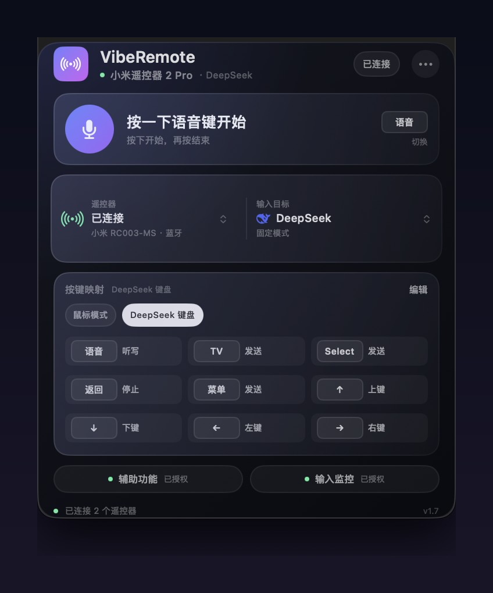
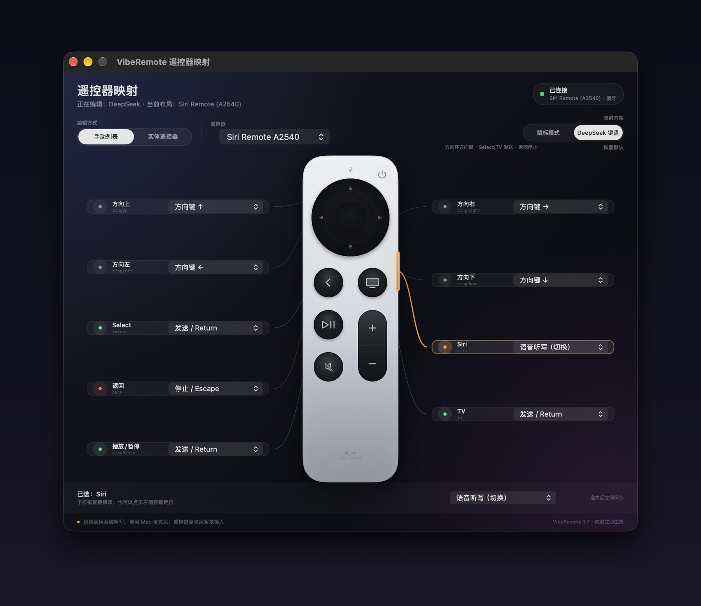
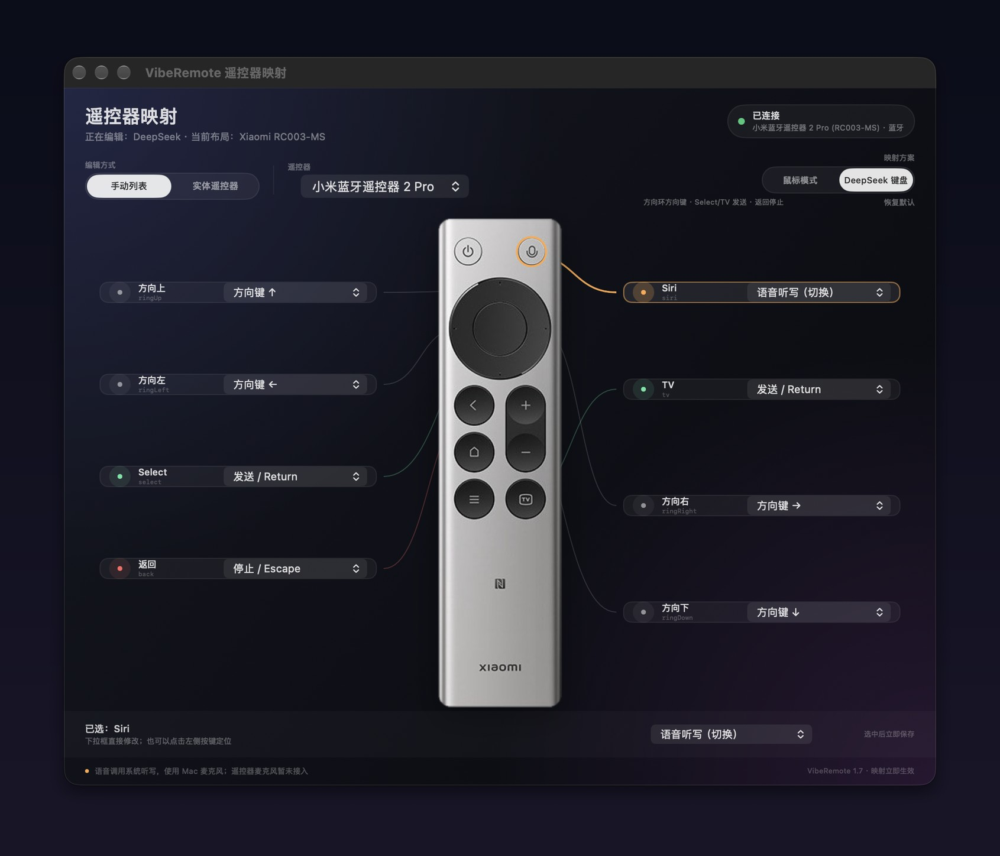
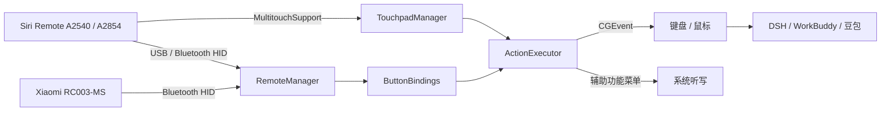

# VibeRemote

**把 Siri Remote / 小米蓝牙遥控器 2 Pro 变成 macOS 上的 Vibe Coding 遥控器。**

按一下语音键说话，TV 发送，返回停止，方向环当鼠标。

一个常驻菜单栏的原生 macOS 小工具，让写代码这件事更像在玩。

[](https://www.apple.com/macos/)
[](https://swift.org)
[](https://github.com/ipgtzuo/viberemote/releases/latest)
[](LICENSE)



## 为什么做这个

用语音和遥控器写代码，不需要在键盘、鼠标、麦克风之间来回切换：

- 按一下 **Siri / 语音键** 开始听写，说完再按一下结束
- 按 **TV** 发送 Return，让 DSH 开始生成
- 按 **返回** 发送 Escape，停止生成
- 方向环控制鼠标或方向键，**Select** 点按 / 拖拽 / 发送
- 按应用自动切换 DeepSeek / WorkBuddy / 豆包键位

它不是要替代键盘，而是把“说一句、发出去、停一下”变成肌肉记忆。

## 功能

| 功能 | 说明 |
|---|---|
| 双遥控器 | Siri Remote A2540 / A2854 与 Xiaomi RC003-MS 可同时连接 |
| 遥控器选择 | 面板内直接切换自动 / Siri / 小米，预览各自布局 |
| 连接状态 | 显示已连接数量、设备名、蓝牙传输和电量 |
| 输入目标 | 固定模式，或跟随前台 App 自动切换 DeepSeek / WorkBuddy / 豆包 |
| 映射方案 | 鼠标模式 / DeepSeek 键盘预设，当前方案高亮 |
| 按键映射 | 面板内直接点按每个按键修改动作，支持键盘、鼠标、滚动、拖拽、语音 |
| 品牌图标 | DeepSeek、WorkBuddy、豆包使用各自真实应用图标 |
| 自动切换 | 跟随前台 App 切换对应模式，每个模式独立保存键位 |
| 触摸板 | 蓝牙连接后，一指移动、两指滚动 |
| 电量显示 | 蓝牙连接时读取遥控器电量 |
| 首次向导 | 连接、权限、语音测试，三步完成设置 |
| 语音自检 | 独立测试窗口，显示权限、按键、听写状态并可复制诊断 |
| 主题 | 自动 / 淡色 / 深色 |
| 本地运行 | 不上传按键、语音或使用数据 |

## 界面

### 菜单栏面板

连接、输入目标、映射预设和权限状态都在一个面板里；遥控器、输入目标和按键映射都可以直接点开修改。面板效果见顶部主图。

### 实体遥控器映射

左右两侧是动作卡片，中间是实体遥控器布局，引导线指向对应按键。

**Siri Remote A2540**



**Xiaomi RC003-MS**

连接小米遥控器后，映射窗口会自动切换成 RC003-MS 的实体布局。



## 工作方式



- **IOKit HID** 读取遥控器按键
- **MultitouchSupport**（私有框架）读取 Siri Remote 触摸板
- **CGEvent** 合成键盘、鼠标、滚动和拖拽
- **辅助功能** 调用当前 App 的“编辑 → 开始/停止听写”
- **NSWorkspace** 监听前台 App，实现自动模式
- **SwiftUI + AppKit** 构建菜单栏面板和映射窗口

## 环境要求

- macOS 13 或更高
- 目前主要在 Apple Silicon Mac 上验证
- Apple TV Siri Remote：
  - **A2540**（Lightning）
  - **A2854**（USB-C）
- 或 Xiaomi Bluetooth Remote 2 Pro **RC003-MS**（蓝牙 HID）

> 应用使用了 `MultitouchSupport.framework` 私有 API，因此不适合上架 Mac App Store。

## 安装

### 下载 DMG

从 [Releases](https://github.com/ipgtzuo/viberemote/releases/latest) 下载最新的 `VibeRemote-1.7.dmg`，打开后把 **VibeRemote** 拖进 `Applications`。

应用不会出现在 Dock，启动后看菜单栏的遥控器图标。

### 从源码构建

```bash
git clone https://github.com/ipgtzuo/viberemote.git
cd viberemote
./build.sh
open dist/VibeRemote.app
```

打包 DMG：

```bash
./package.sh
```

## 第一次使用

### 1. 连接遥控器

**Siri Remote（A2540 / A2854）**：插上 USB 即可识别按键；触摸板和电量需要蓝牙。

**小米蓝牙遥控器 2 Pro（RC003-MS）**：

1. 打开 **系统设置 → 蓝牙**，让页面保持可见
2. 同时按住遥控器的 **菜单键 + HOME 键**，直到出现 `小米蓝牙语音遥控器`
3. 点“连接”

连接后 VibeRemote 会自动切换到 RC003-MS 实体布局。语音键、OK、返回、方向键、TV / 主页可用；音量和电源键暂未映射。

两个遥控器可以同时连接。面板顶部的“遥控器”区域会显示已连接数量，并允许切换当前预览的遥控器。

### 2. 授权

VibeRemote 需要两个权限：

- **输入监控**：读取遥控器 HID 按键
- **辅助功能**：发送 Return、Escape、方向键、鼠标事件，以及调用系统听写菜单

在菜单栏面板点 **“去授权”**，打开对应开关。  
授权后从面板的 `•••` 菜单点 **“重新连接遥控器”**。

应用本身不请求麦克风权限；语音由 macOS 系统听写处理。

### 3. 语音听写

1. 把光标放进目标输入框
2. **按一下 Siri / 语音键** 开始听写
3. 说完后 **再按一下** 结束
4. 等系统返回识别结果

VibeRemote 会优先通过辅助功能点击当前 App 的 **编辑 → 开始听写… / 停止听写**，因此不依赖“按住 Fn”快捷键；如果菜单不可用，再回退到 Fn。

使用前确认：

- 光标在输入框里
- 系统设置 → 键盘 → 听写已开启，语言正确
- Mac 麦克风有输入（合盖使用外接显示器时，内置麦克风可能不可用）

> 语音使用 **Mac 麦克风 + macOS 系统听写**，不是遥控器麦克风。Siri Remote 的麦克风是 Apple 私有协议；Xiaomi RC003-MS 的 ATVV 音频尚未接入。

## 默认键位

### DeepSeek 键盘

| 遥控器 | 动作 |
|---|---|
| Siri / 语音 | 开始 / 结束语音听写 |
| TV | Return：发送 |
| Select | Return：发送 |
| 返回 / Menu | Escape：停止 |
| 播放 / 暂停 | Return：发送 |
| 方向环 | 上 / 下 / 左 / 右方向键 |

### 鼠标模式

| 遥控器 | 动作 |
|---|---|
| Siri / 语音 | 开始 / 结束语音听写 |
| TV | Return：发送 |
| 返回 / Menu | Escape：停止 |
| 方向环 | 鼠标光标移动 |
| Select / 中心 | 鼠标左键；按住再移动方向环 = 拖拽 |
| 播放 / 暂停 | 切换滚动 / 光标模式 |

## 模式

| 模式 | 默认行为 |
|---|---|
| DeepSeek | 语音 + Return 发送 + Escape 停止 + 键盘方向键 |
| WorkBuddy | 语音 + Return 发送 + Escape 停止 |
| 豆包 | 语音 + Return 发送 + Escape 停止 |
| 通用 | 鼠标与键盘通用映射 |
| 自动 | 跟随前台 App 自动切换 |

每个模式的键位独立保存，互不影响。

## 项目结构

```text
Sources/
  RemoteManager.swift          IOKit HID 遥控器
  TouchpadManager.swift        MultitouchSupport 触摸板
  ButtonBindings.swift         按键映射、预设与持久化
  ActionExecutor.swift         CGEvent / 辅助功能动作
  AppMode.swift                应用模式、品牌图标与自动切换
  Appearance.swift             主题
  MappingSettingsView.swift    映射窗口
  VibeRemoteView.swift         菜单栏面板
  VibeRemoteModel.swift        状态与生命周期
Resources/
  Info.plist
  AppIcon.icns
  RC003MS.png                  RC003-MS 实物图
  BrandDeepSeek.png
  BrandWorkBuddy.png
  BrandDoubao.png
docs/
  panel.jpg
  mapping-apple.jpg
  mapping-xiaomi.jpg
build.sh
package.sh
```

## 已知限制

- 语音使用 Mac 麦克风 + macOS 系统听写；Siri Remote 麦克风不被 macOS 暴露
- Xiaomi RC003-MS 的遥控器麦克风尚未接入，后续可走 ATVV + 本地语音识别
- USB-C 下触摸板和电量不可用，需要蓝牙
- 需要输入监控和辅助功能权限
- Xiaomi RC003-MS 为实验性支持，已验证 HID 主按键和语音键；音量、电源键未接入
- 未在 Intel Mac 上验证
- 私有触摸板 API 可能随 macOS 版本变化

## Roadmap

- [ ] Xiaomi RC003-MS 遥控器麦克风（ATVV）
- [ ] 更细的触摸板手势
- [ ] 每个应用的自定义配置导入 / 导出
- [ ] 遥控器电量低提醒
- [ ] 可选的本地语音识别
- [ ] 更多遥控器型号

## License

[MIT](LICENSE)

VibeRemote 与 Apple、ByteDance、DeepSeek 无关联。Apple TV、Siri Remote 是 Apple Inc. 的商标。
