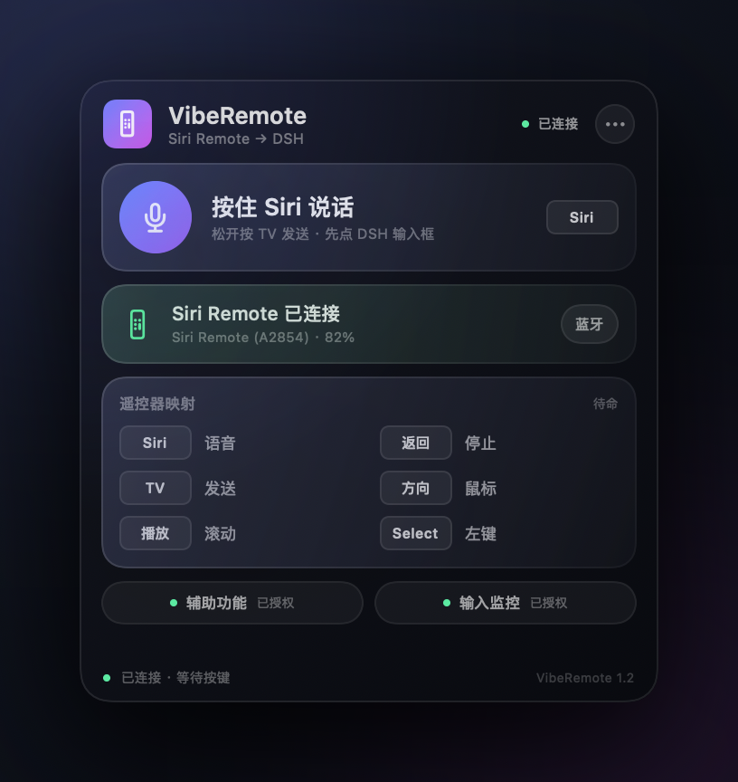
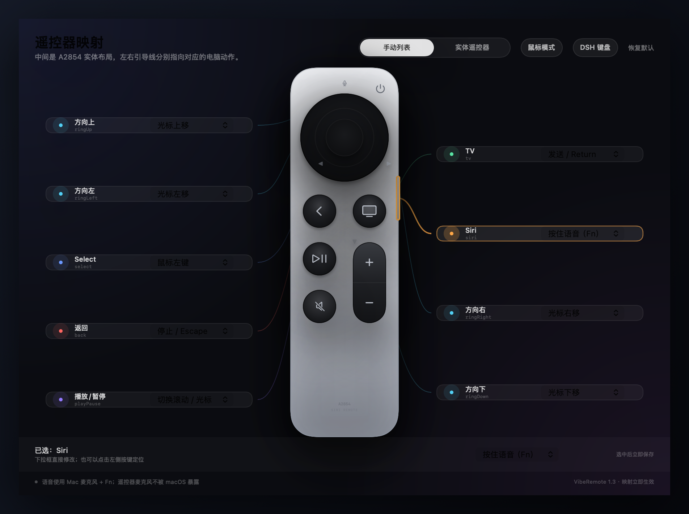
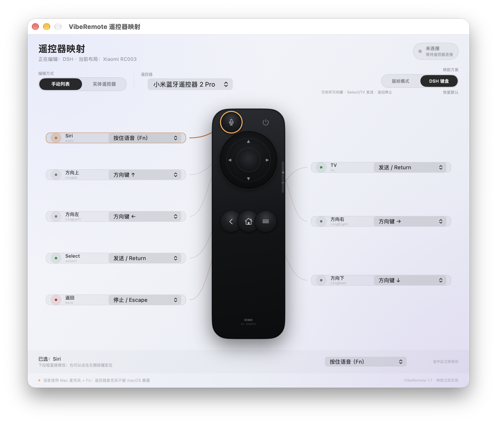
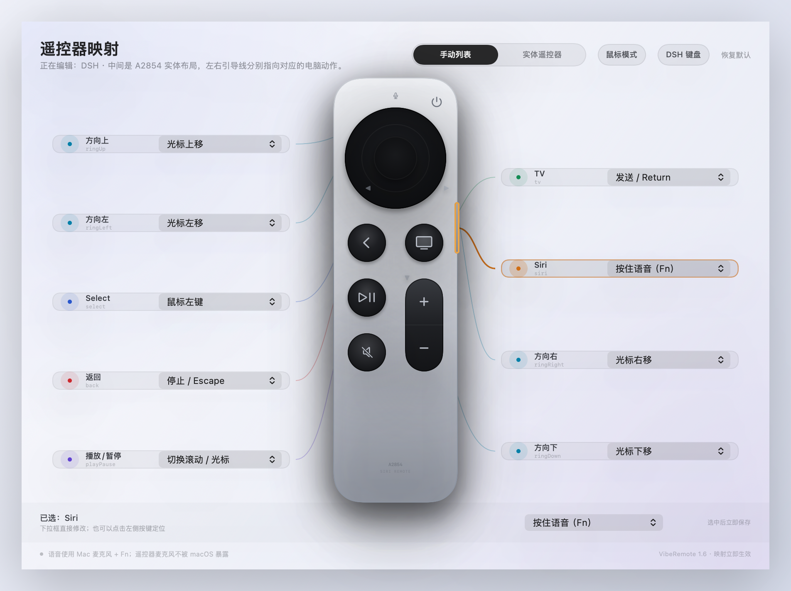
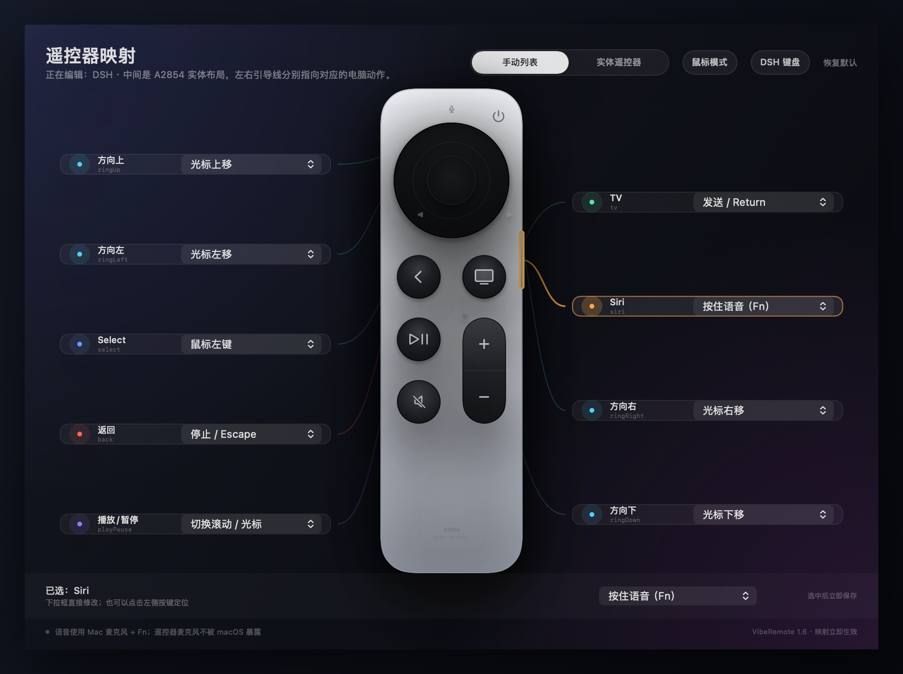
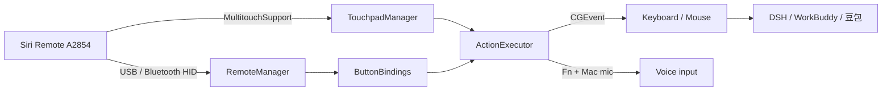

# VibeRemote

**把 Siri Remote / 小米蓝牙遥控器 2 Pro 变成 macOS 上的 Vibe Coding 遥控器。**

按住 Siri 说话，TV 发送，返回停止，方向环当鼠标。  
一个常驻菜单栏的原生 macOS 小工具，让写代码这件事更像在玩。

[](https://www.apple.com/macos/)
[](https://swift.org)
[](https://github.com/ipgtzuo/viberemote/releases/latest)
[](LICENSE)



## 为什么做这个

用语音和遥控器写代码，不需要在键盘、鼠标、麦克风之间来回切换：

- 按住 **Siri** 说需求，松开后自动按住 Mac 的 **Fn** 听写
- 按 **TV** 发送 Return，让 DSH 开始生成
- 按 **返回** 发送 Escape，停止生成
- 方向环控制鼠标，**Select** 点按/拖拽
- 按应用自动切换 DSH / WorkBuddy / 豆包键位

它不是要替代键盘，而是把“说一句、发出去、停一下”变成肌肉记忆。

## 功能

| 功能 | 说明 |
|---|---|
| 多遥控器 | Siri Remote A2854；Xiaomi Bluetooth Remote 2 Pro (RC003) |
| 按键映射 | 每个按键可绑定键盘、鼠标、滚动、拖拽、语音 |
| 多模式 | DSH、WorkBuddy、豆包、通用；每个模式独立键位 |
| 自动切换 | 跟随前台 App 自动切换对应模式 |
| 触摸板 | 蓝牙连接后，一指移动、两指滚动 |
| 电量显示 | 蓝牙连接时读取遥控器电量 |
| 主题 | 自动 / 淡色 / 深色 |
| 本地运行 | 不上传按键、语音或使用数据 |

## 界面

### 实体遥控器映射

左右两侧是动作卡片，中间是 A2854 实体布局，引导线指向对应按键。



### Xiaomi RC003

连接 Xiaomi 2 Pro 后，映射窗口会自动切换成 RC003 的实体按键布局。



### 淡色 / 深色

<table>
  <tr>
    <td></td>
    <td></td>
  </tr>
</table>

## 工作方式



- **IOKit HID** 读取遥控器按键
- **MultitouchSupport**（私有框架）读取触摸板
- **CGEvent** 合成键盘、鼠标、滚动和拖拽
- **NSWorkspace** 监听前台 App，实现自动模式
- **SwiftUI + AppKit** 构建菜单栏面板和映射窗口

## 环境要求

- macOS 13 或更高
- Apple Silicon Mac
- Apple TV Siri Remote **A2854**（USB-C），或
- Xiaomi Bluetooth Remote 2 Pro **RC003**（蓝牙 HID）
- 可选：Siri Remote 蓝牙配对后使用触摸板和电量

> 应用使用了 `MultitouchSupport.framework` 私有 API，因此不适合上架 Mac App Store。

## 安装

### 下载 DMG

从 [Releases](https://github.com/ipgtzuo/viberemote/releases/latest) 下载最新的 `VibeRemote-1.7.dmg`，打开后把 **VibeRemote** 拖进 `Applications`。

应用不会出现在 Dock，启动后看菜单栏的遥控器图标。

### 从源码构建

```bash
git clone https://github.com/ipgtzuo/viberemote.git
cd viberemote
./build.sh
open dist/VibeRemote.app
```

打包 DMG：

```bash
./package.sh
```

## 第一次使用

### 1. 连接遥控器

**Siri Remote USB-C**：插上即可识别，按键可用；触摸板和电量需要蓝牙。

**小米蓝牙遥控器 2 Pro**：

1. 打开 **系统设置 → 蓝牙**，让页面保持可见
2. 同时按住遥控器的 **菜单键 + HOME 键**，直到出现 `小米蓝牙语音遥控器`
3. 点“连接”

连接后 VibeRemote 会自动切换到 RC003 实体布局。语音键、OK、返回、方向键、TV / 主页可用；音量和电源键暂未映射。

**蓝牙**：

1. 给遥控器充电，拔掉 Apple TV 电源，避免 Apple TV 抢回遥控器
2. 打开 **系统设置 → 蓝牙**
3. 拔掉 USB-C，把遥控器靠近 Mac
4. 同时按住 **返回 `<` + 音量加 `+`** 约 5 秒
5. 在“附近的设备”里连接 `Siri Remote`

### 2. 授权

VibeRemote 需要两个权限：

- **输入监控**：读取遥控器 HID 按键
- **辅助功能**：发送 Return、Escape、方向键、鼠标事件和 Fn

在菜单栏面板点 **“去授权”**，打开对应开关。  
授权后从 `•••` 菜单点 **“重新连接遥控器”**。

### 3. 语音

按住 Siri 时，VibeRemote 会：

1. 激活目标 App
2. 等 160ms
3. 按住 Fn，松开 Siri 时释放

语音走 **macOS 的 Fn 听写/输入法语音**，不是遥控器麦克风。

使用前确认：

- 光标在输入框里
- 系统设置 → 键盘 → 听写 → 快捷键设为 **按下 Fn**
- 或输入法支持按住 Fn 语音

## 默认键位（鼠标模式）

| 遥控器 | 动作 |
|---|---|
| 按住 Siri | 开始语音；松开结束 |
| TV | Return：发送 |
| 播放 / 暂停 | 切换滚动 / 光标模式 |
| 返回 / Menu | Escape：停止 |
| 方向环 | 鼠标光标移动 |
| Select / 中心 | 鼠标左键；按住再移动方向环 = 拖拽 |

## 模式

| 模式 | 默认行为 |
|---|---|
| DSH | 语音 + Return 发送 + Escape 停止 + 鼠标 |
| WorkBuddy | 语音 + Return 发送 + Escape 停止 |
| 豆包 | 语音 + Return 发送 + Escape 停止 |
| 通用 | 鼠标与键盘通用映射 |
| 自动 | 跟随前台 App 自动切换 |

每个模式的键位独立保存，互不影响。

## 项目结构

```text
Sources/
  RemoteManager.swift          IOKit HID 遥控器
  TouchpadManager.swift       MultitouchSupport 触摸板
  ButtonBindings.swift        按键映射与持久化
  ActionExecutor.swift        CGEvent 键鼠执行
  AppMode.swift               应用模式与自动切换
  Appearance.swift            主题
  MappingSettingsView.swift   映射窗口
  VibeRemoteView.swift        菜单栏面板
  VibeRemoteModel.swift       状态与生命周期
Resources/
  Info.plist
  AppIcon.icns
build.sh
package.sh
```

## 已知限制

- 遥控器麦克风不被 macOS 暴露，语音使用 Mac 麦克风 + Fn
- USB-C 下触摸板和电量不可用，需要蓝牙
- 需要输入监控和辅助功能权限
- Xiaomi RC003 为实验性支持，仅验证了 HID 协议和主按键映射；音量、电源键未接入
- 未在 Intel Mac 上验证
- 私有触摸板 API 可能随 macOS 版本变化

## Roadmap

- [ ] 更细的触摸板手势
- [ ] 每个应用的自定义配置导入/导出
- [ ] 遥控器电量低提醒
- [ ] 可选的本地语音识别
- [ ] 更多遥控器型号

## License

[MIT](LICENSE)

VibeRemote 与 Apple、ByteDance、DeepSeek 无关联。Apple TV、Siri Remote 是 Apple Inc. 的商标。
